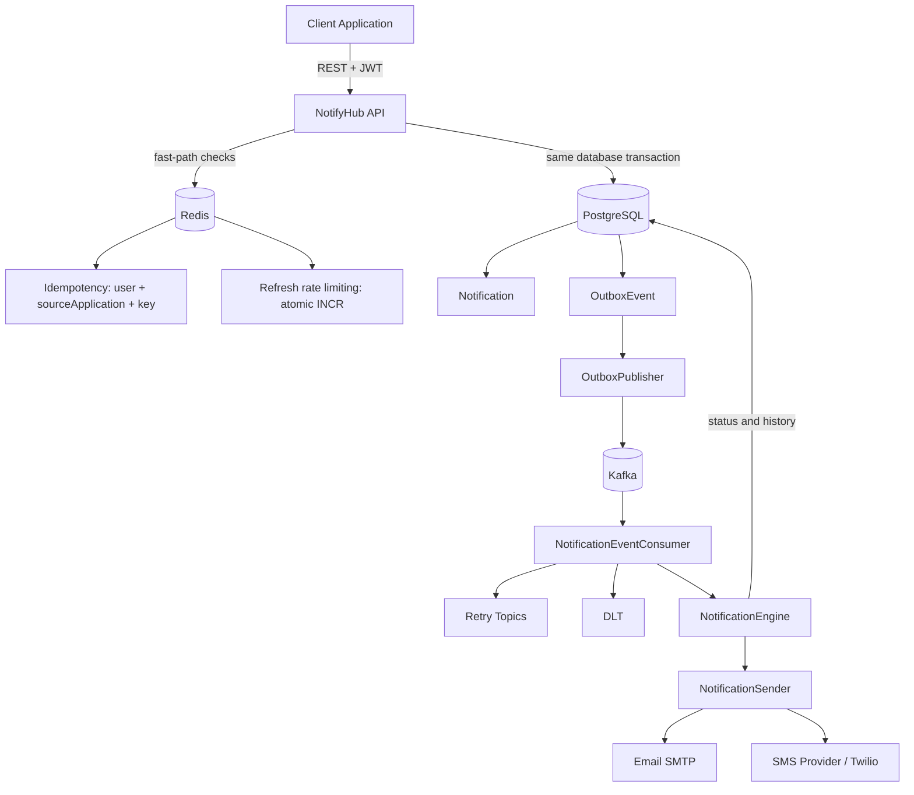
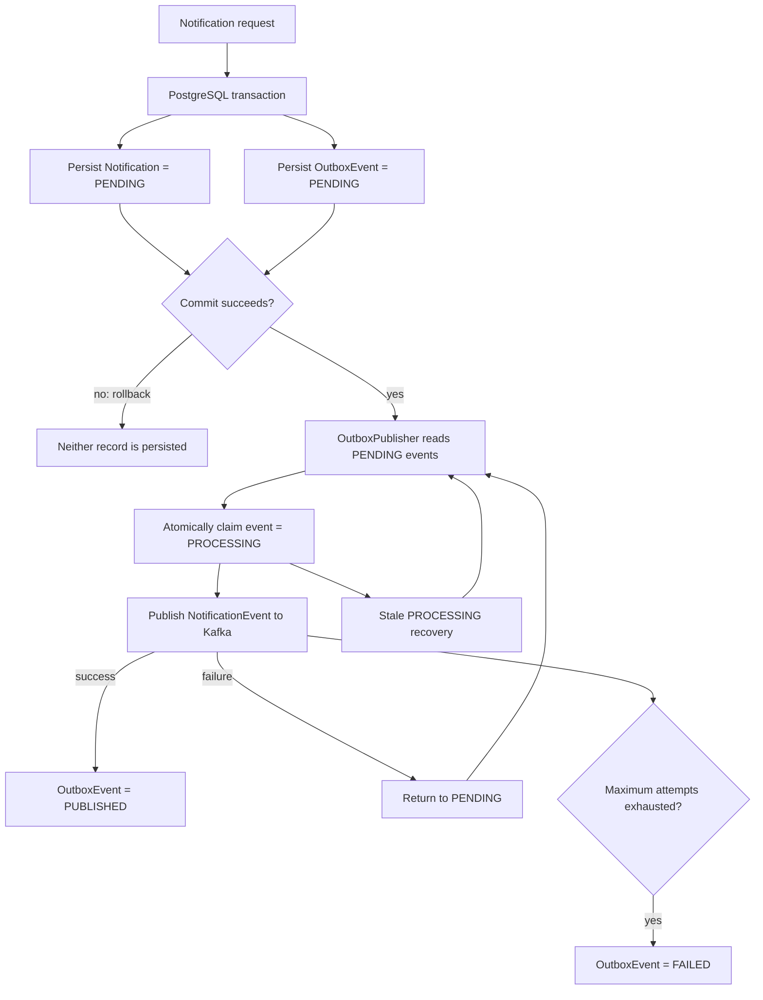
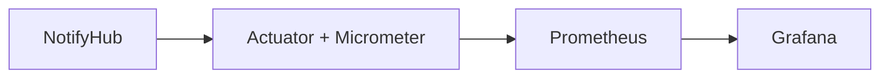

# NotifyHub

NotifyHub is a Java 17 / Spring Boot 3.4 notification microservice. Client applications submit authenticated notification requests through REST; NotifyHub persists the notification and its outbox event transactionally, publishes events through Kafka, and delivers email or SMS asynchronously.

## Overview

NotifyHub provides:

- Email delivery through SMTP.
- SMS delivery through a strategy/provider abstraction with Twilio support.
- JWT authentication, rotating refresh tokens, revocation, and Google OAuth2 login.
- Centralized notification templates with activation/deactivation.
- User-owned notification history with filtering and pagination.
- Redis fast-path idempotency backed by an authoritative PostgreSQL uniqueness constraint.
- Redis-backed refresh-token rate limiting.
- Transactional Outbox publication to Kafka, retry topics, and a DLT.
- Actuator, Micrometer, Prometheus, and Grafana observability.

## Core capabilities

| Feature | Current implementation |
| --- | --- |
| Email | SMTP provider |
| SMS | Strategy/provider architecture with Twilio support |
| Async processing | Apache Kafka |
| Reliable event publication | Transactional Outbox |
| Idempotency | Redis fast-path + PostgreSQL authoritative uniqueness |
| Idempotency scope | `user + sourceApplication + idempotencyKey` |
| Templates | CRUD plus activation/deactivation |
| Notification history | Filtered/paginated with user ownership |
| Authentication | JWT |
| Refresh tokens | HttpOnly cookie, rotation, and revocation |
| Refresh rate limiting | Redis-backed, 5 requests / 60 seconds |
| Authorization | `USER` role |
| OAuth2 | Google |
| Retry | 3 total consumer attempts with exponential backoff |
| DLT | Kafka Dead Letter Topic |
| Database | PostgreSQL + Flyway |
| Cache/fast-path | Redis |
| Observability | Actuator + Micrometer + Prometheus + Grafana |
| Custom metrics | Notification, Outbox, and Kafka metrics |
| API documentation | Swagger/OpenAPI |
| Containerization | Docker + Docker Compose |
| Testing | JUnit 5 + Mockito + MockMvc + Testcontainers |

## Architecture

### System architecture



The API returns `202 Accepted` after the notification and outbox event have been persisted. Kafka publication is performed by the outbox publisher, not by a direct API-to-Kafka callback.

### Transactional Outbox flow



The outbox publisher processes pending events in batches, uses atomic claim logic, tracks attempts, retries failed publication with bounded attempts, and recovers stale `PROCESSING` events. The outbox states are:

- `PENDING`: waiting for Kafka publication.
- `PROCESSING`: currently claimed by a publisher.
- `PUBLISHED`: Kafka publication succeeded.
- `FAILED`: maximum publication attempts were exhausted.

This design prevents the database/Kafka dual-write problem by storing `Notification` and `OutboxEvent` atomically in PostgreSQL. It provides retry-based, at-least-once-style event publication behavior; it does not claim exactly-once delivery.

### Observability flow



Actuator exposes `/actuator/metrics` and `/actuator/prometheus`. Prometheus scrapes the latter using `monitoring/prometheus.yml`; Grafana dashboards are not automatically provisioned.

## Notification flow

1. The client sends `POST /api/v1/notifications` with JWT authentication.
2. Spring Security and request validation authenticate and validate the request.
3. Redis performs the scoped idempotency fast-path check, followed by the PostgreSQL scoped uniqueness check.
4. NotifyHub resolves raw content or renders the selected template.
5. A `Notification` with status `PENDING` and an `OutboxEvent` with status `PENDING` are saved in the same PostgreSQL transaction.
6. If the transaction rolls back, neither record is persisted.
7. `OutboxPublisher` finds pending events, claims one, deserializes the event, and publishes it to Kafka.
8. Successful publication marks the outbox event `PUBLISHED`; a failure returns it to `PENDING` until its maximum attempts are exhausted, after which it becomes `FAILED`.
9. `NotificationEventConsumer` receives the Kafka event and hands it to `NotificationEngine`.
10. `NotificationEngine` resolves the sender and delivers through SMTP or the configured SMS provider.
11. Successful delivery updates the notification to `SENT`; provider failure sets it to `RETRYING`.
12. Consumer failures use retry topics for three total attempts. After the final failure, the DLT handler marks the notification `FAILED`.
13. Scheduled stale-event recovery returns old `PROCESSING` outbox events to `PENDING`, unless their attempts are exhausted.

## Idempotency

Every notification request requires both `idempotencyKey` and `sourceApplication`.

The Redis fast-path key is conceptually:

```text
notifyhub:idempotency:<userId>:<sourceApplication>:<idempotencyKey>
```

Redis uses a short-lived `SET NX` marker to reject duplicates quickly and avoid unnecessary database work. Redis is not the authoritative guarantee: its marker can expire or Redis can restart.

PostgreSQL is the source of truth and enforces:

```text
UNIQUE (user_id, source_application, idempotency_key)
```

This protects the final write against races and remains authoritative when Redis state is unavailable or expired. A duplicate request returns `409 Conflict`. The Redis fast-path is intentionally retained for performance, while PostgreSQL provides the durable uniqueness guarantee.

## Refresh-token rate limiting

Refresh-token requests are limited by a Redis-backed counter:

- Maximum 5 requests per 60-second window per client key.
- Atomic Redis `INCR` operation.
- A 60-second TTL is set when the counter is created.
- Redis namespace: `notifyhub:rate-limit:refresh:<key>`.
- State is stored in Redis so the limiter can be shared across application instances.

## Retry and DLT

Consumer processing uses Spring Kafka `@RetryableTopic` with three total attempts: the initial delivery plus two retries. The configured exponential backoff is 1 second and then 2 seconds. Retry topics and a DLT are managed by Spring Kafka.

Provider failures are represented as `RETRYING` while retry processing continues. When the event reaches the DLT, the notification is marked `FAILED` and a generic DLT failure reason is stored.

Kafka producer reliability configuration in the local and production profiles is:

| Setting | Value |
| --- | --- |
| `acks` | `all` |
| `enable-idempotence` | `true` |
| `retries` | `5` |
| `delivery-timeout-ms` | `120000` |
| `request-timeout-ms` | `30000` |
| `max-in-flight-requests-per-connection` | `5` |

## Templates

```text
Subject: Your NotifyHub Order Confirmation
Body:    Hello {{name}}, your order {{orderId}} has been confirmed.
```

- `data` values are substituted into `{{placeholders}}`.
- Missing template data or a null data object returns `400 Bad Request`; placeholders are not silently blanked.
- `DELETE` deactivates a template instead of removing it.
- Inactive templates cannot be used for sending.
- Templates are shared across authenticated users.

## API

All protected endpoints require an `Authorization: Bearer <JWT>` header.

### Authentication

| Method | Path | Description |
| --- | --- | --- |
| POST | `/auth/register` | Create a user with role `USER` |
| POST | `/auth/login` | Return an access token and set the `refresh_token` cookie |
| POST | `/auth/refresh` | Rotate the refresh token and return a new access token |
| POST | `/auth/logout` | Revoke the refresh token and clear the cookie |
| GET | `/oauth2/authorization/google` | Start Google OAuth2 login |

### Templates

| Method | Path | Description |
| --- | --- | --- |
| POST | `/api/v1/templates` | Create a template (`201`) |
| GET | `/api/v1/templates/{code}` | Fetch a template |
| PUT | `/api/v1/templates/{code}` | Update channel, subject, and body |
| DELETE | `/api/v1/templates/{code}` | Deactivate a template (`204`) |

### Notifications

| Method | Path | Description |
| --- | --- | --- |
| POST | `/api/v1/notifications` | Send a notification (`202`) |
| GET | `/api/v1/notifications/{id}` | Fetch one of the authenticated user's notifications |
| GET | `/api/v1/notifications` | List owned notifications with filters and pagination |

**Send with a template**

```http
POST /api/v1/notifications
Authorization: Bearer <JWT>
Content-Type: application/json
```

```json
{
  "channel": "EMAIL",
  "recipient": "user@example.com",
  "templateCode": "ORDER_CONFIRMATION",
  "data": { "name": "Honey", "orderId": "ORD-1001" },
  "idempotencyKey": "order-confirmation-001",
  "sourceApplication": "orders-service"
}
```

**Send raw content**

```json
{
  "channel": "EMAIL",
  "recipient": "user@example.com",
  "rawSubject": "Welcome to NotifyHub",
  "rawBody": "Hello, welcome!",
  "idempotencyKey": "welcome-001",
  "sourceApplication": "accounts-service"
}
```

Provide either `templateCode` or raw content, not both. Supported channels are `EMAIL` and `SMS`.

**History filters**

```text
GET /api/v1/notifications?status=FAILED&channel=EMAIL&fromDate=2026-09-01T00:00:00&page=0&size=20
```

Query parameters are `recipient`, `status`, `channel`, `fromDate`, `toDate`, and Spring `page` / `size` / `sort`. Page size is limited to 100.

Swagger UI is available at `/swagger-ui/index.html`.

## Security

- Access tokens are JWTs with a default lifetime of 15 minutes (`JWT_EXPIRATION`).
- Refresh tokens are random values stored as SHA-256 hashes in PostgreSQL.
- Refresh tokens are grouped into families and rotated on every refresh.
- The refresh cookie is HttpOnly, `SameSite=Strict`, scoped to `/auth`, and controlled by `COOKIE_SECURE`.
- All notification and template API endpoints require the `USER` role.
- Users can read only their own notifications.
- Recipients are masked in logs.
- `Notification` uses optimistic locking through a JPA `@Version` field.
- `/actuator/health` and `/actuator/prometheus` are public in the current security configuration; restrict Prometheus access at the network level in production.

## Observability

The application uses Spring Boot Actuator, Micrometer, and the Prometheus registry. The following logical metric names are registered:

| Metric | Meaning |
| --- | --- |
| `notifyhub.notifications.created` | Notifications persisted, tagged by channel |
| `notifyhub.notifications.sent` | Notifications successfully delivered, tagged by channel |
| `notifyhub.notifications.failed` | Notifications marked failed by the DLT handler, tagged by channel |
| `notifyhub.notifications.processing.duration` | Notification delivery processing timer, tagged by channel |
| `notifyhub.outbox.published` | Successful outbox publications |
| `notifyhub.outbox.failed` | Failed outbox publication attempts |
| `notifyhub.outbox.recovered` | Stale processing events returned to pending |
| `notifyhub.kafka.publish.failures` | Kafka producer publish failures |

Notification metrics use only the low-cardinality `channel` tag. Notification IDs, user IDs, email addresses, phone numbers, and idempotency keys are not metric tags.

Metrics are available through:

- `/actuator/metrics`
- `/actuator/prometheus`

Prometheus normalizes names for exposition. For example:

```text
notifyhub.notifications.created
    -> notifyhub_notifications_created_total
```

Grafana can visualize the Prometheus data, but this repository does not automatically provision dashboards.

## Tech stack

| Area | Technology |
| --- | --- |
| Language / framework | Java 17, Spring Boot 3.4.5, Spring Web, Spring Validation |
| Persistence | Spring Data JPA, PostgreSQL 15, Flyway |
| Messaging | Apache Kafka with Spring Kafka, KRaft mode |
| Cache / fast-path | Redis 7 with Spring Data Redis |
| Security | Spring Security, OAuth2 Resource Server JWT, Google OAuth2 Client |
| Delivery | Spring Mail SMTP, Twilio SDK, provider abstractions |
| API documentation | springdoc OpenAPI / Swagger UI |
| Observability | Spring Boot Actuator, Micrometer, Prometheus, Grafana |
| Testing | JUnit 5, Mockito, MockMvc, Testcontainers |
| Build / run | Maven wrapper, Docker, Docker Compose |

## Prerequisites

- Java 17 or newer.
- Docker and Docker Compose for the local stack and Testcontainers integration tests.

Maven is not required locally; use the included `./mvnw` wrapper.

## Configuration

```bash
cp .env.example .env
```

Fill in environment-specific values and never commit `.env`.

| Variable | Purpose |
| --- | --- |
| `DB_URL`, `DB_USERNAME`, `DB_PASSWORD` | PostgreSQL connection |
| `REDIS_HOST`, `REDIS_PORT`, `REDIS_DATABASE` | Redis connection |
| `MAIL_HOST`, `MAIL_PORT`, `MAIL_USERNAME`, `MAIL_PASSWORD` | SMTP server |
| `EMAIL_PROVIDER` | `SMTP` (default) or `GENERIC` |
| `SMS_PROVIDER` | `TWILIO` (default), `GENERIC`, or `CLIENT_CUSTOM` |
| `TWILIO_ACCOUNT_SID`, `TWILIO_AUTH_TOKEN`, `TWILIO_PHONE_NUMBER` | Twilio credentials |
| `JWT_SECRET`, `JWT_EXPIRATION` | JWT signing secret and access-token lifetime in seconds |
| `REFRESH_TOKEN_EXPIRATION` | Refresh-token lifetime in seconds |
| `GOOGLE_CLIENT_ID`, `GOOGLE_CLIENT_SECRET` | Google OAuth2 login |
| `COOKIE_SECURE` | Secure flag on the refresh cookie |
| `KAFKA_BOOTSTRAP_SERVERS` | Kafka address |
| `KAFKA_CONSUMER_GROUP_ID` | Kafka consumer group in profiles that define it |
| `SPRING_PROFILES_ACTIVE` | `local` or `prod` |

The Docker Compose application overrides database, Redis, and Kafka addresses with service names (`postgres`, `redis`, and `kafka`). Localhost values in `.env` apply to non-containerized runs.

## Docker setup

```bash
docker compose up -d --build
docker compose ps
curl http://localhost:8081/actuator/health
```

Expected health response:

```json
{"status":"UP"}
```

| Service | URL |
| --- | --- |
| NotifyHub | http://localhost:8081 |
| Swagger UI | http://localhost:8081/swagger-ui/index.html |
| Health | http://localhost:8081/actuator/health |
| Prometheus | http://localhost:9090 |
| Grafana | http://localhost:3000 |

Compose starts NotifyHub, PostgreSQL, Redis, Kafka in KRaft mode, Prometheus, and Grafana. Prometheus uses `monitoring/prometheus.yml` and scrapes `app:8080/actuator/prometheus`.

Grafana dashboards are not pre-provisioned. Add Prometheus at `http://prometheus:9090` as a data source and create or import dashboards as needed.

## Running locally

Start PostgreSQL, Redis, and Kafka:

```bash
docker compose up -d postgres redis kafka
./mvnw spring-boot:run -Dspring-boot.run.profiles=local
```

The local application runs on `http://localhost:8080`. Compose maps the container to port `8081` on the host.

## Testing

Run the complete suite with:

```bash
./mvnw clean test
```

The final full Maven run for this project passed:

```text
73 tests, 0 failures, 0 errors, 0 skipped
```

Coverage includes:

- JUnit 5 unit tests.
- Mockito service, engine, sender, outbox, producer, consumer, rate-limiter, and metrics tests.
- MockMvc controller tests.
- PostgreSQL, Kafka, and Redis integration scenarios through Testcontainers.
- Idempotency scope and Redis duplicate-acquisition tests.
- Outbox publication, failure, stale recovery, and retry/DLT scenarios.
- Notification delivery success and provider failure paths.

Docker must be running for Testcontainers-based tests.

## Project structure

```text
notifyhub/
├── src/main/java/com/notifyhub/
│   ├── config/          OpenAPI configuration
│   ├── engine/          NotificationEngine and delivery status updates
│   ├── enums/           Channel, notification, and outbox statuses
│   ├── exception/       Global exception handler and custom exceptions
│   ├── messaging/       Kafka config, producer, consumer, events, and outbox
│   ├── monitoring/      NotifyHub Micrometer metrics
│   ├── notification/    controller, service, repository, entity, DTO, mapper,
│   │                    idempotency, email, SMS, sender, and specifications
│   ├── security/        authentication, JWT, refresh tokens, rate limiter,
│   │                    and Google OAuth2
│   └── template/        controller, service, renderer, repository, entity, DTO
├── src/main/resources/
│   ├── application*.yml
│   └── db/migration/    Flyway migrations
├── src/test/            unit and integration tests
├── monitoring/          prometheus.yml
├── docker-compose.yml
├── Dockerfile
└── .env.example
```

## Design principles and architecture decisions

- **Separation of concerns:** controllers, services, repositories, senders, messaging, security, and monitoring have focused responsibilities.
- **SOLID and dependency injection:** Spring-managed collaborators are injected into application components.
- **Layered architecture:** REST, application service, persistence, messaging, and delivery layers are separated.
- **Strategy Pattern:** email and SMS providers are selected through `NotificationSender` implementations.
- **Idempotency:** Redis provides a fast-path and PostgreSQL provides the authoritative scoped uniqueness constraint.
- **Transactional Outbox Pattern:** the notification and Kafka outbox event are persisted atomically before asynchronous publication.
- **Asynchronous processing:** Kafka decouples API acceptance from provider delivery.
- **Retry + DLT:** consumer failures use retry topics and a DLT; outbox publication has bounded attempts.
- **Optimistic locking:** notification status updates use JPA versioning.
- **Database constraints:** PostgreSQL and Flyway enforce durable schema and uniqueness rules.
- **Transactional consistency:** `Notification` and `OutboxEvent` share the same database transaction.
- **Observability:** Actuator and Micrometer expose low-cardinality metrics to Prometheus and Grafana.
- **Redis-backed rate limiting:** refresh-token requests use an atomic, TTL-based Redis counter.

## Known limitations

- Redis is required for the notification idempotency fast-path; there is no PostgreSQL-only fallback if Redis is unavailable.
- If a notification request fails after acquiring its Redis idempotency marker but before persistence, the scoped marker can reject an immediate retry until its short TTL expires.
- The application currently has a single `USER` role.
- Templates are shared across authenticated users.
- DLT failure reasons are generic; the last provider error is retained while the notification is `RETRYING`.
- Push notifications and WhatsApp are not implemented.
- Multi-tenant billing, quotas, and tenant administration are not implemented.
- Grafana dashboards are not automatically provisioned.
- Kafka and PostgreSQL are separate systems; the outbox makes publication recoverable but does not provide exactly-once delivery.

## Author

**Honey Chauhan** — built as a backend engineering project covering Spring Boot, Kafka, Redis, PostgreSQL, Docker, security, testing, and observability.
